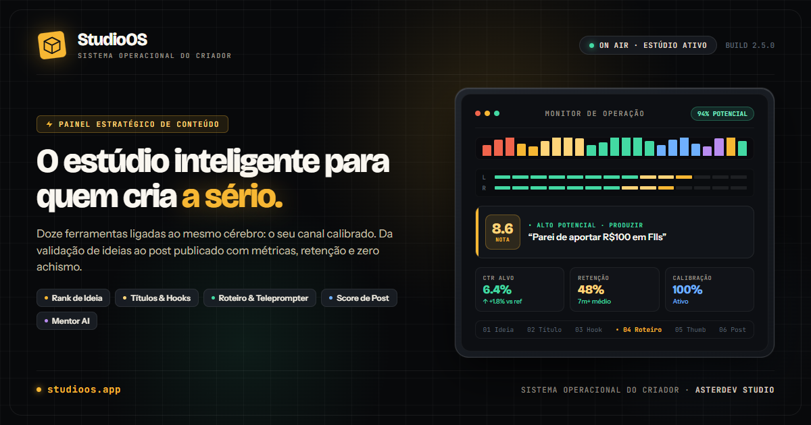
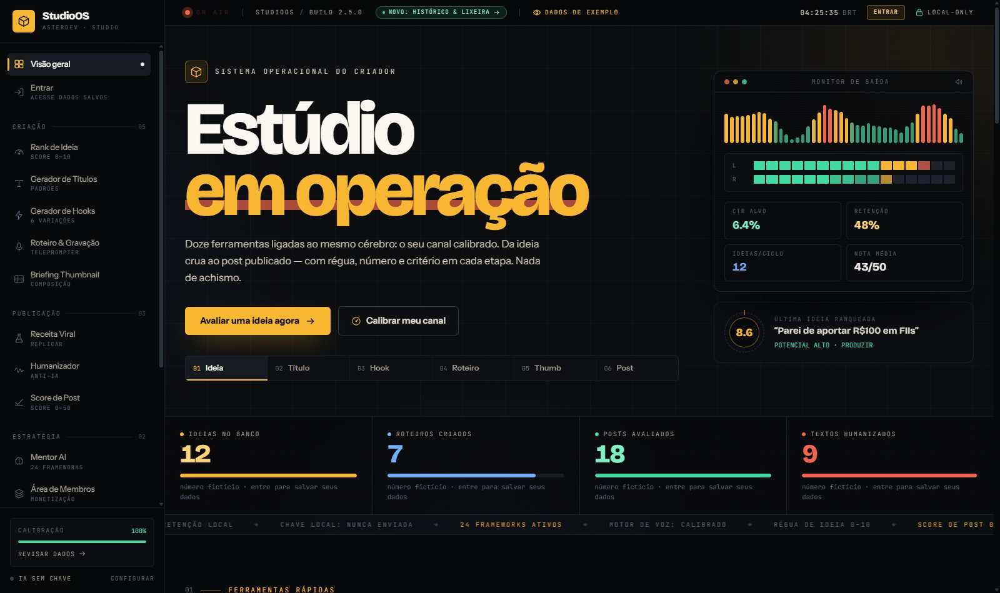
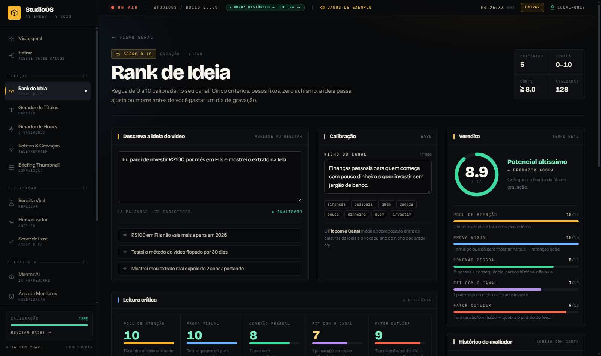

# StudioOS

<p align="center">
  
</p>

<p align="center">
  <strong>O Sistema Operacional para quem cria conteúdo a sério.</strong><br />
  Doze ferramentas conectadas ao mesmo cérebro: o seu canal calibrado. Da validação da ideia ao post publicado — com métricas reais, retenção projetada e zero achismo.
</p>

<p align="center">
  
  
  
  
  
</p>

---

## Prévia Oficial



### Visão Geral do Painel



### Validação Estratégica: Rank de Ideia



---

## Por que o StudioOS?

A maioria dos criadores perde tempo pulando entre blocos de notas, planilhas e prompts genéricos de IA que não entendem o tom de voz do canal.

O **StudioOS** centraliza todo o fluxo operacional:
1. **Calibração Central**: Defina uma única vez o nicho, persona, tom de voz e referências do canal. Todas as ferramentas herdam essa base automaticamente.
2. **Esteira Integrada de Conteúdo**: Passe de etapa em etapa (`Ideia → Título → Hook → Roteiro → Thumbnail → Post`) mantendo o contexto.
3. **Métricas Antes da Gravação**: Preveja CTR, retenção estimada e potencial de viralidade com pontuações objetivas.

---

## Suíte de Ferramentas

### 🎬 Criação
- **Rank de Ideia**: Avaliação algorítmica de 0 a 10 com base em novidade, apelo de clique, tensão e viabilidade.
- **Gerador de Títulos**: Padrões testados de alta curiosidade e clareza, alinhados ao estilo do canal.
- **Gerador de Hooks**: 6 variações de abertura com retenção projetada para os primeiros 3 a 5 segundos de vídeo.
- **Roteiro & Teleprompter**: Estruturação em 3 atos com cálculo de ritmo de fala e teleprompter em tela cheia com velocidade ajustável.
- **Briefing Thumbnail**: Composição visual, pontos focais, expressões e paleta para designers ou geração visual.

### 📢 Publicação
- **Receita Viral**: Desconstrução de formatos em alta para replicação ética no seu nicho.
- **Humanizador**: Elimina vícios de linguagem robóticos e confere naturalidade ao texto.
- **Score de Post**: Checklist completo de pontuação antes do upload final (copy, timing, ganchos e CTA).

### 🧠 Estratégia & Monetização
- **Mentor AI**: Consultor estratégico em tempo real para posicionamento e tomadas de decisão.
- **Área de Membros**: Planejamento de entregáveis, esteira de produtos e retenção de assinantes.

### 📁 Gestão & Colaboração
- **Calibração do Canal**: Base de dados do seu público, promessa principal e regras inegociáveis.
- **Projetos de Conteúdo**: Pastas temáticas com chat de IA dedicado por projeto (`ProjetoAIChat`).
- **Banco de Ideias & Salvos**: Organização ágil de conceitos em standby e favoritos.
- **Perfis Públicos de Criadores (`/perfil/@handle`)**: Página pública de apresentação com estatísticas, links de redes, projetos em destaque, avaliações e curtidas.
- **Sistema VIP**: Badges exclusivos, personalização de cor RGB e recursos prioritários.
- **Histórico & Lixeira**: Recuperação de análises passadas com retenção e limpeza configuráveis.

---

## Compartilhamento Social & Open Graph

O StudioOS inclui suporte completo a **Open Graph (OG)** e **Twitter Cards** para garantir prévias impecáveis no WhatsApp, Discord, X/Twitter, LinkedIn, Slack e Telegram:

- **Imagem de Produção**: `public/og.png` (1200 × 630 px, proporção 1.91:1)
- **Fallback**: `public/og-image.png`
- **Template HTML Pixel-Perfect**: `public/og-template.html` (renderizado nativamente com fontes e gráficos oficiais)
- **Metadados Injetados**: Configuráveis via propriedades no [Layout.astro](src/layouts/Layout.astro).

---

## Acesso e Autenticação

- **Modo Visitante / Demonstração**: É possível explorar o painel, testar as ferramentas e simular análises imediatamente sem necessidade de cadastro.
- **Conta Demo 24h**: Criação instantânea com um clique sem necessidade de e-mail, ideal para testes temporários.
- **Contas Persistentes**: Login e cadastro com e-mail/senha ou provedores OAuth (**Google** e **Discord**) gerenciados via Supabase Auth.
- **Segurança de Dados**: O histórico sensível e calibrações ficam seguros via Row Level Security (RLS) no Supabase e armazenamento local protegido no navegador.

---

## Requisitos do Sistema

- **Node.js**: `>=22.12.0`
- **Gerenciador de pacotes**: `npm` (ou `pnpm` / `yarn`)

---

## Desenvolvimento Local

Clone o repositório e instale as dependências:

```sh
npm install
```

Inicie o servidor de desenvolvimento do Astro em segundo plano:

```sh
npm run dev
```

> O comando inicia o Astro em segundo plano via `astro dev --background`. Acesse [http://localhost:4321](http://localhost:4321).

### Gerenciamento do Servidor em Segundo Plano

```sh
npx astro dev status   # Verifica o status e a porta ativa
npx astro dev logs     # Exibe os logs do servidor em tempo real
npx astro dev stop     # Encerra o processo do servidor
```

---

## Configuração do Supabase

1. Copie o arquivo de variáveis de ambiente:
   ```sh
   cp .env.example .env
   ```
2. No painel do seu projeto Supabase (**Project Settings → API**), copie as credenciais e preencha no `.env`:
   ```env
   PUBLIC_SUPABASE_URL=https://seu-projeto.supabase.co
   PUBLIC_SUPABASE_ANON_KEY=sua-chave-publica-anon
   ```
3. Execute o script [supabase/schema.sql](supabase/schema.sql) no SQL Editor do Supabase para criar as tabelas e políticas de acesso (RLS).
4. *(Opcional)* Habilite os provedores Google e Discord em **Authentication → Providers**.
5. Reinicie o servidor Astro.

> ⚠️ **Aviso de Segurança**: Utilize exclusivamente a chave pública `anon` no front-end. Nunca utilize a chave `service_role` em variáveis públicas ou código cliente.

---

## Estrutura do Projeto

```text
src/
├── pages/                  # Rotas e páginas Astro (SSR)
│   ├── index.astro         # Painel principal do estúdio
│   ├── login.astro         # Tela dedicada de acesso e cadastro
│   ├── perfil/             # Perfis públicos dinâmicos ([handle].astro)
│   └── api/                # Endpoints e webhooks de autenticação
├── layouts/
│   └── Layout.astro        # Layout base, fontes Google e metadados Open Graph
├── studio/                 # Aplicação React do StudioOS
│   ├── components/         # StatusBar, Console, VipBadge, Modais e UI
│   ├── tools/              # 12 ferramentas de criação, publicação e análise
│   ├── views/              # Telas: Home, Auth, Projetos, Perfil, Ranking, Histórico
│   └── lib/                # Clientes Supabase (SSR e cliente)
├── styles/
│   └── studio.css          # Tema global, design tokens e Tailwind CSS v4
public/
├── logo.svg & logo.png     # Logotipo oficial StudioOS
├── favicon.svg             # Favicon vetorial
├── og.png & og-image.png   # Imagem Open Graph oficial (1200x630)
└── og-template.html        # Template HTML de renderização da OG Image
docs/
└── images/                 # Capturas de tela e documentação visual
supabase/
└── schema.sql              # Esquema SQL do banco de dados e políticas RLS
```

---

## Tecnologias

- **Framework**: [Astro 7](https://astro.build/) com renderização híbrida/SSR
- **Interface**: [React 19](https://react.dev/) + [TypeScript](https://www.typescriptlang.org/)
- **Estilização**: [Tailwind CSS v4](https://tailwindcss.com/)
- **Backend & Auth**: [Supabase Auth & PostgreSQL](https://supabase.com/)
- **Deployment & Edge Runtime**: [Cloudflare Workers Adapter](https://developers.cloudflare.com/workers/)
- **Tipografia**: `Bricolage Grotesque`, `Instrument Sans` e `JetBrains Mono`

---

<p align="center">
  Desenvolvido com foco em criadores por <strong>AsterDev Studio</strong> &bull; Zero Achismo.
</p>
